# Shubh Mishra

Software engineer focused on backend systems, database internals, and agentic AI. I'm finishing my MS in Computer Science at USC (December 2026) after nearly two years at Oracle building multi-tenant services.

**Looking for full-time software engineering roles.**

[Portfolio](https://shubhmishra.vercel.app) · [LinkedIn](https://www.linkedin.com/in/shubhmishra19/) · [Email](mailto:mishrashubh.1912@gmail.com)

## Selected projects

**Trailhead: multi-agent trip planner** 
A LangGraph supervisor dispatches parallel RAG, live-conditions, and logistics agents with MCP-connected tools, streaming cited answers from GCP Cloud Run. A rule-based Gemini and Claude router cut LLM cost per query 70% versus all-Claude, and retrieval scored 0.98 faithfulness and 0.97 context recall on 36 RAGAS test questions. 
`Python` `LangGraph` `MCP` `Pinecone` `FastAPI` `Firestore` `GCP Cloud Run`

**[PostgreSQL B-tree and prefetching optimizations](https://github.com/shubh-1912/postgresql-17.4-optimized)** 
Reduced index-scan read latency 15% on a 50M-row workload by optimizing B-tree descent, and lowered sequential-scan I/O wait 20% with asynchronous page prefetching. 
`C` `PostgreSQL internals` `Docker`

**[DuckDB query scheduler](https://github.com/shubh-1912/duckdb-mlfq)** 
Implemented a multi-level feedback queue in DuckDB's execution engine, increasing concurrent throughput 25% on TPC-H SF100 and cutting p95 latency for sub-second queries from 1,850 ms to 240 ms. 
`C++` `DuckDB internals` `LLDB`

**[KickScout: visual similarity search](https://github.com/shubh-1912/project-kickscout)** 
Zero-shot image search API over a 44K-item fashion catalog, serving top-k matches from 512-dimensional CLIP embeddings through Neo4j's HNSW vector index. 
`Python` `PyTorch` `CLIP` `Neo4j` `FastAPI`

**Weenix: UNIX-like kernel** 
Implemented 20+ POSIX system calls, preemptive scheduling, a virtual file system, and thread synchronization primitives. 
`C` `GDB` `Operating systems`

## Experience

**USC Auxiliary Services**, Assistant Forward Deployed Engineer (June 2026 to August 2026) 
Built an operations dashboard on an ETL pipeline processing 100K+ daily point-of-sale transactions, using LLM-based data extraction to normalize invoices and receipts across inconsistent vendor formats.

**Oracle**, Software Engineer (July 2023 to May 2025) 
Built a multi-tenant webhook delivery subsystem with .NET Core and Kafka, and scaled 6 microservices to 180 peak requests/sec at 140 ms p99 and 99.95% availability.

## Tech

| Area | Tools |
|---|---|
| Languages | Python, C, C++, C#, Go, Java, SQL, TypeScript |
| Agentic AI | LangGraph, LangChain, MCP, RAG, multi-agent systems, LLM routing, RAGAS, Claude Code |
| Backend | FastAPI, .NET Core, REST APIs, Kafka, microservices, distributed systems |
| Data | PostgreSQL, Oracle DB, DuckDB, Neo4j, Pinecone, Firestore |
| Infrastructure | GCP, OCI, Docker, Kubernetes, Linux, CI/CD, OpenTelemetry |

## GitHub stats

   
  

Includes private repositories. Language stats leave out upstream PostgreSQL source code.

